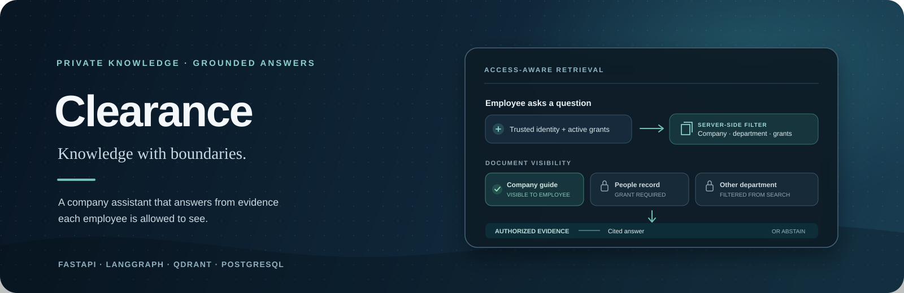
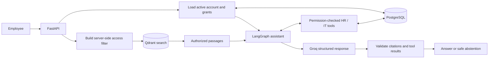

<div align="center">



<br />

[](https://clearance-theta-three.vercel.app/)
[](https://clearance-api-nine.vercel.app/docs)

<br />

`PYTHON` &nbsp; · &nbsp; `FASTAPI` &nbsp; · &nbsp; `LANGGRAPH` &nbsp; · &nbsp; `QDRANT` &nbsp; · &nbsp; `POSTGRESQL`

</div>

<br />

> **The idea** &nbsp; Ask questions about a fictional company’s internal knowledge base. Clearance retrieves evidence the signed-in employee is allowed to see, answers with citations, and abstains when it cannot support an answer.

## ◈ Explore

<div align="center">

| &nbsp;01&nbsp; **The assistant** | &nbsp;02&nbsp; **Access model** | &nbsp;03&nbsp; **Quick start** | &nbsp;04&nbsp; **Evaluation** |
|:---:|:---:|:---:|:---:|
| [What it does](#the-assistant) | [How access works](#access-is-part-of-retrieval) | [Run with Docker](#run-the-demo-locally) | [What is measured](#evaluation) |

</div>

## The assistant

Clearance is a learning project for permission-aware retrieval-augmented generation. It combines a company knowledge base with employee-specific HR and IT tools, while keeping the user’s identity and access checks on the server.

- **Answers with evidence** — responses cite retrieved passages, and citations are checked against the sources returned by search.
- **Search respects access** — active company documents, same-department documents, and explicitly granted restricted versions are filtered before retrieval results reach the model.
- **Employee-specific tools** — the assistant can read permitted leave balances and IT tickets. Creating an IT ticket requires `confirm_actions: true` on that request.
- **Demo and sign-in flows** — use fictional demo identities locally, or authenticate with a password and short-lived bearer token.
- **Admin grant controls** — administrators can add, list, and revoke access to restricted document versions.
- **Evaluation scripts** — measure retrieval quality and access-boundary behavior on a synthetic question set; optional answer evaluation makes live Groq calls.

> **Synthetic data only:** the company, policies, employees, and records in this repository are fictional. Do not add real company or personal documents.

## Access is part of retrieval

Clearance derives identity from the authenticated account, then applies document visibility rules inside the API. Role, department, and grants supplied by a browser request are not used to construct the access filter. The model only receives passages retrieved for that user.



### What the access rules allow

| Content or action | Who can access it |
|---|---|
| Active company-wide documents | All active users |
| Active department documents | Active users in that department |
| Active restricted document versions | Users with a grant for that exact version; administrators manage grants |
| Leave balance | The employee; HR managers and administrators can look up another active user |
| IT ticket list | The signed-in employee |
| Create an IT ticket | Only when the request explicitly sets `confirm_actions: true` |

The local `X-Demo-User-ID` flow is a learning shortcut, not production authentication. Demo routes are disabled when `DEMO_MODE` is false.

## Run the demo locally

### Requirements

- Docker Desktop with Docker Compose
- Python 3.14.10 and [`uv`](https://docs.astral.sh/uv/) for local development outside Docker
- A [Groq API key](https://console.groq.com/keys)

### Start the full app

1. Create a local environment file and set a database password, Groq key, and private JWT secret of at least 32 characters:

   ```sh
   cp .env.example .env
   ```

2. Build and start PostgreSQL, Qdrant, the API, and the web app:

   ```sh
   docker compose up -d --build
   ```

3. Prepare the database, fictional users, and search index:

   ```sh
   docker compose exec api uv run --no-sync alembic upgrade head
   docker compose exec api uv run --no-sync python scripts/seed_demo_users.py
   docker compose exec api uv run --no-sync python scripts/import_knowledge_metadata.py
   docker compose exec api uv run --no-sync python scripts/create_qdrant_collection.py
   docker compose exec api uv run --no-sync python scripts/index_knowledge_base.py
   ```

   The seed script asks for one local demo password and stores its Argon2 hash for six fictional accounts. The current corpus has 41 document versions and indexes to 44 searchable chunks. FastEmbed downloads its embedding model on first indexing.

4. Open the app and API:

   - Web app: <http://127.0.0.1:8080>
   - API docs: <http://127.0.0.1:8000/docs>
   - Liveness: <http://127.0.0.1:8000/health>
   - Database readiness: <http://127.0.0.1:8000/ready>

Stop the containers with `docker compose down`. Named volumes preserve PostgreSQL and Qdrant data across restarts. The `.env` file is ignored by Git; keep credentials there and never commit them.

### Run the API and Vite separately

Use Docker for PostgreSQL and Qdrant, then install and prepare the API from the repository root:

```sh
uv sync
cp .env.example .env
docker compose up -d postgres qdrant
uv run alembic upgrade head
uv run python scripts/seed_demo_users.py
uv run python scripts/import_knowledge_metadata.py
uv run python scripts/create_qdrant_collection.py
uv run python scripts/index_knowledge_base.py
uv run fastapi dev src/clearance/main.py
```

In another terminal, run the frontend:

```sh
cd frontend
npm ci
npm run dev
```

Vite prints the local URL and forwards `/demo`, `/auth`, and `/api` requests to the API. If you switch from the full Compose app to local API/Vite, stop its `api` and `frontend` services first with `docker compose stop api frontend`.

## API at a glance

The interactive reference is available at `/docs` when the API is running.

| Route | Purpose |
|---|---|
| `POST /auth/login` | Verify credentials and issue a short-lived bearer token |
| `GET /auth/me` | Return the active signed-in user |
| `POST /api/ask` | Ask as the authenticated user |
| `POST /demo/ask` | Ask using the local demo identity header |
| `GET /demo/users` | List fictional users when demo mode is enabled |
| `GET /demo/search?question=...` | Inspect permission-filtered search results |
| `/api/admin/documents/{id}/versions/{version}/grants` | List, add, or revoke version-specific grants (admin only) |
| `GET /health` · `GET /ready` | Check API liveness and database readiness |

## Evaluation

Run retrieval and access checks after the local database, demo users, document metadata, and Qdrant collection are ready:

```sh
uv run python scripts/run_evaluation.py --output reports/generated/evaluation.json
```

Add `--answers` to make live Groq calls and measure abstention accuracy and citation overlap; those calls may incur provider charges. Grant-dependent cases are skipped if the required grant is missing. Citation overlap is not a semantic faithfulness score, and the small synthetic question set is not evidence of production quality or zero leakage risk.

The checked-in evaluation snapshot reports:

| Metric | Result | Context |
|---|---:|---|
| Document precision at top 5 | 0.875 | 7 measured cases; one grant-required case skipped |
| Document recall at top 5 | 1.000 | Same run; score threshold 0.68 |
| Access leakage cases | 0 / 7 | Synthetic boundary cases; one case skipped |
| Faithfulness | Not measured | Requires semantic review |
| p50 / p95 latency | Not measured | — |
| Cost per question | Not measured | — |

These values are a small smoke evaluation against synthetic data. Re-run the scripts against your configured services before drawing conclusions; the generated report is local and ignored by Git.

## Deployment

The public demo uses the fictional corpus only:

- [Clearance web app](https://clearance-theta-three.vercel.app/)
- [FastAPI service](https://clearance-api-nine.vercel.app/)

The hosted setup uses Vercel for the frontend and API, Neon for PostgreSQL, and Qdrant Cloud for vectors. For the API project, set `POSTGRES_DB`, `POSTGRES_USER`, `POSTGRES_PASSWORD`, `POSTGRES_HOST`, `POSTGRES_PORT=5432`, `POSTGRES_SSL=true`, `POSTGRES_POOLER=true`, `GROQ_API_KEY`, `JWT_SECRET_KEY`, `QDRANT_URL`, `QDRANT_API_KEY`, `DEMO_MODE=true`, and `FRONTEND_ORIGINS` to the exact frontend origin. For the frontend project, set `VITE_API_BASE_URL` to the API origin and `VITE_DEMO_MODE=true`. Values starting with `VITE_` are public browser settings; never put secrets in them.

For the one-time hosted data setup, use a private local env file such as `.env.hosted` (ignored by Git) with the hosted database and Qdrant credentials. Point it at Neon's **direct** endpoint and set `POSTGRES_POOLER=false` for migrations. Then run `uv run alembic upgrade head`, `uv run python scripts/seed_demo_users.py`, `uv run python scripts/import_knowledge_metadata.py`, `uv run python scripts/create_qdrant_collection.py`, and `uv run python scripts/index_knowledge_base.py`. See `.env.example`, `vercel.json`, and `frontend/` for the remaining project configuration.

## Built with

**API and assistant:** Python 3.14 · FastAPI · Pydantic · SQLAlchemy · Alembic · LangGraph · MCP · Groq<br />
**Data and retrieval:** PostgreSQL · Qdrant · FastEmbed<br />
**Web and delivery:** React · Vite · Nginx · Docker Compose · Vercel

## Repository map

```text
src/clearance/       API, auth, retrieval, assistant workflow, and tools
frontend/            Vite web app
migrations/          Alembic database migrations
scripts/             Demo setup, indexing, and evaluation commands
evaluation/          Synthetic golden questions
CLEARANCE_SYNTHETIC_KNOWLEDGE_BASE.md
                     Fictional source documents used by the demo
```

---

<div align="center">

**Clearance** · A learning project in trustworthy, permission-aware AI search.

</div>
