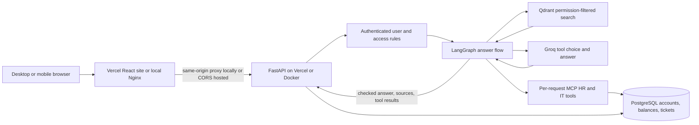

# Clearance

Clearance is a learning project for a permission-aware company knowledge assistant. It answers questions from a fictional company's internal documents, cites its sources, and limits retrieval and tools using the authenticated user's access.

> **Synthetic data only:** The company and all policies, people, projects, and figures in this repository are fictional. Do not add real company or personal documents.

## What the project demonstrates

- Retrieval-augmented generation over versioned company documents.
- Server-side access filters derived from authenticated identity.
- Role-specific answers with citations and safe abstention.
- Permission checks inside HR and IT tools exposed through an in-process MCP server.
- A LangGraph workflow that combines document search with employee-specific tools.
- Evaluation of retrieval quality, faithfulness, leakage rate, latency, and cost per question.

## Learning workflow

The project is built in small, verified steps. This README will be updated at each checkpoint with verified setup instructions, design decisions, and measured results.

## Synthetic knowledge base

`CLEARANCE_SYNTHETIC_KNOWLEDGE_BASE.md` contains fictional Company, People Operations, IT Operations, Finance, and Product Strategy records. It includes department and restricted material, active and superseded versions, effective dates, and evaluation prompts. The app must use trusted server-side identity to filter this material.

## Stack

Python, FastAPI, Pydantic v2, SQLAlchemy, Alembic, PostgreSQL, Qdrant, FastEmbed, LangGraph, an MCP server, Groq, React + Vite, Nginx, Docker Compose, and planned Vercel + Neon + Qdrant Cloud hosting. Package versions and provider limits will be checked against current official documentation when each installation or integration step begins.

## Setup and run

### Prerequisites

- Python 3.14.10 and `uv`
- Docker Desktop with Docker Compose
- A Groq API key

### Run the full app in Docker

1. Copy `.env.example` to `.env`, then set the PostgreSQL password, Groq API key, and a private random `JWT_SECRET_KEY` (at least 32 characters). Keep `.env` local; Git ignores it, and Docker does not copy it into either image.
2. Build the API and frontend images and start all four services with `docker compose up -d --build`.
3. Create or update the database tables with `docker compose exec api uv run --no-sync alembic upgrade head`.
4. Create or reset the fictional users and balances with `docker compose exec api uv run --no-sync python scripts/seed_demo_users.py`. The script asks for one local demo password and saves only its Argon2 hash for the six demo accounts.
5. Import document details into PostgreSQL with `docker compose exec api uv run --no-sync python scripts/import_knowledge_metadata.py`.
6. Create the Qdrant collection and its access-filter indexes with `docker compose exec api uv run --no-sync python scripts/create_qdrant_collection.py`.
7. Index the source corpus with `docker compose exec api uv run --no-sync python scripts/index_knowledge_base.py`. FastEmbed downloads its model the first time it runs; the corpus currently produces 44 searchable chunks.
8. Check service state with `docker compose ps`. Open the frontend at `http://127.0.0.1:8080`; the API docs are at `http://127.0.0.1:8000/docs`.
9. Check the API through the frontend proxy with `curl http://127.0.0.1:8080/health` and `curl http://127.0.0.1:8080/ready`. The first checks that the API responds; the second also checks its PostgreSQL connection.
10. In demo mode, open the app to switch between fictional users. The API and Nginx containers communicate over Compose's private network; PostgreSQL and Qdrant keep their data in named volumes.
11. Stop the containers with `docker compose down`. The named database and vector volumes remain for the next start.

### Run services locally for development

If you previously started the full Docker app, stop its API and frontend containers with `docker compose stop api frontend` before starting the API and Vite directly on your Mac. PostgreSQL and Qdrant can stay running.

1. Install the locked Python dependencies with `uv sync`.
2. Copy `.env.example` to `.env`, then set the PostgreSQL password, Groq API key, and a private random `JWT_SECRET_KEY` (at least 32 characters). `QDRANT_SCORE_THRESHOLD` defaults to `0.68` and can be adjusted between `0` and `1` to control how close a search result must be before the assistant sees it. Keep `.env` local; it is ignored by Git.
3. Start only PostgreSQL and Qdrant with `docker compose up -d postgres qdrant`.
4. Apply the database migrations with `uv run alembic upgrade head`. This creates the user, document, per-user grant, leave-balance, and IT-ticket tables and adds the account security fields.
5. Add or update the fictional local users and leave balances with `uv run python scripts/seed_demo_users.py`. It asks for one local demo password (at least 12 characters) and saves only its Argon2 hash for all six demo accounts. The Sofia Gigante account is marked as the local knowledge administrator. Run the script again to reset their shared local password and account setup.
6. Import document details into PostgreSQL with `uv run python scripts/import_knowledge_metadata.py`. The current corpus has 41 document versions.
7. Create the Qdrant collection and its access-filter indexes with `uv run python scripts/create_qdrant_collection.py`.
8. Index the source corpus with `uv run python scripts/index_knowledge_base.py`. FastEmbed creates vectors locally; the first run downloads its model. At this checkpoint, the corpus produces 44 searchable chunks.
9. Run `uv run pytest -q` to check permission filters, password and token handling, answer validation, and Groq usage handling.
10. Check service state with `docker compose ps`. PostgreSQL is published on `127.0.0.1:5433`; Qdrant is published on `127.0.0.1:6333` (HTTP) and `127.0.0.1:6334` (gRPC).
11. Start the API with `uv run fastapi dev src/clearance/main.py`. It listens on `http://127.0.0.1:8000` and provides interactive API docs at `/docs`.
12. Check `curl http://127.0.0.1:8000/health` and `curl http://127.0.0.1:8000/ready`. The first checks that the API responds; the second also checks its Postgres connection.
13. In demo mode, `GET /demo/users` lists the fictional users, `GET /demo/whoami` accepts the `X-Demo-User-ID` header to select one, and `GET /demo/search` searches the indexed documents for that user. These routes are a local learning shortcut, not production sign-in.
14. Run `uv run python scripts/groq_baseline.py` to make two short Groq calls and view their answers, token counts, response time, and estimated cost. The results are sample observations, not an answer-quality evaluation.
15. Ask from the indexed corpus with `curl -X POST http://127.0.0.1:8000/demo/ask -H 'Content-Type: application/json' -H 'X-Demo-User-ID: 2' -d '{"question":"Where should employees report an IT incident?"}'`. This demo route uses filtered search, returns citations only from retrieved chunks, and abstains when it lacks authorized evidence.
16. Sign in with `curl -X POST http://127.0.0.1:8000/auth/login -H 'Content-Type: application/json' -d '{"email":"mikasa.ackerman@astervale.example","password":"YOUR_LOCAL_DEMO_PASSWORD"}'`. The response contains a short-lived bearer token.
17. Send an authenticated ask with `curl -X POST http://127.0.0.1:8000/api/ask -H 'Content-Type: application/json' -H 'Authorization: Bearer YOUR_ACCESS_TOKEN' -d '{"question":"Where should employees report an IT incident?"}'`. The API loads the active account from PostgreSQL for each request; it does not trust role or department values from the token or request.
18. Check the signed-in identity with `curl http://127.0.0.1:8000/auth/me -H 'Authorization: Bearer YOUR_ACCESS_TOKEN'`.
19. Give one user access to the active restricted HR-005 version with `curl -X POST http://127.0.0.1:8000/api/admin/documents/HR-005/versions/1.0/grants -H 'Content-Type: application/json' -H 'Authorization: Bearer SOFIA_ADMIN_TOKEN' -d '{"user_id":TARGET_USER_ID}'`. Replace the placeholders with Sofia's access token and a real user ID. Only an administrator can create, list, or revoke grants; `GET` on that same URL lists grants and `DELETE` on the URL ending in `/TARGET_USER_ID` revokes one.
20. To read your own synthetic leave balance or list your own IT tickets, ask that in `/api/ask` or `/demo/ask`; each successful tool result is included in the response. HR managers may look up another active user's balance. Other users can only read their own.
21. Run retrieval and access checks on the synthetic question set with `uv run python scripts/run_evaluation.py --output reports/generated/evaluation.json`. Grant-dependent cases are skipped when the required active grant is absent. The generated report directory is ignored by Git.
22. Add `--answers` to also ask Groq to answer each evaluation question and measure abstention accuracy and citation overlap. This makes live model calls and may incur provider charges. Citation overlap is not a semantic faithfulness score.
23. To create an IT ticket, send `{"question":"Create an IT ticket for ...","confirm_actions":true}`. This explicitly enables the ticket creation tool for that request; without `confirm_actions:true`, the tool is unavailable. Use a signed-in account for `/api/ask`; demo mode is only a local learning shortcut.
24. In a second terminal, run `cd frontend && npm ci && npm run dev`. Open the Vite address shown in the terminal (usually `http://localhost:5173`). Vite forwards `/demo`, `/auth`, and `/api` requests to the API on port `8000`.
25. In the app, use the profile menu to switch fictional demo identities or sign in with a password. The theme follows your system appearance by default; a manual theme choice is saved in the browser. The Sources and My requests views show results from the current session. Signed-in administrators see an Admin console for adding and removing restricted-document grants; the API checks administrator access on every change.
26. Stop the frontend and API with `Ctrl+C` in their terminals, then stop PostgreSQL and Qdrant with `docker compose down`. Named volumes keep local database and vector data across container restarts.

The table descriptions are in `src/clearance/models.py`, and Alembic migrations under `migrations/` keep database layout changes repeatable. PostgreSQL stores accounts, document details, grants, synthetic leave balances, and IT tickets; Qdrant stores searchable text chunks, vectors, and search metadata. Passwords are stored as Argon2 hashes. `POST /auth/login` issues a short-lived signed token; protected routes check that token and load the current active user record from PostgreSQL. Retrieval allows active company documents, same-department documents, and active restricted versions explicitly granted to that user. It also filters out search matches below `QDRANT_SCORE_THRESHOLD`. Admin-only endpoints can list, add, and revoke grants; grants for old document versions do not expose superseded content. Both ask routes use a LangGraph workflow: it searches only permitted documents, makes employee identity available to MCP tools only from the authenticated server-side user, and returns structured Groq answers with citations checked against retrieved sources. Tool results are checked against the tools actually called. Leave balances are limited to the employee, HR managers, and administrators; ticket lists are limited to the signed-in employee. The ticket creation tool is only registered when `confirm_actions` is true. The React interface provides desktop and mobile layouts, light and dark themes, demo identity switching, password sign-in, source details, session request history, and admin document-grant controls. The `X-Demo-User-ID` header remains a local learning shortcut. Keep credentials in `.env`; never commit API keys or other secrets.

## Hosted preview (Vercel, Neon, and Qdrant Cloud)

The repository is prepared for a hosted preview, but no cloud services are created by these code changes. Keep the corpus synthetic: `DEMO_MODE=true` lets visitors switch between fictional accounts and is not suitable for real company data.

1. Create a Neon PostgreSQL database and a Qdrant Cloud cluster. Keep their connection details and API keys private.
2. Import this Git repository into Vercel twice. For the API project, use the repository root. For the website project, set the root directory to `frontend`.
3. In the API project's Vercel environment variables, set `POSTGRES_DB`, `POSTGRES_USER`, `POSTGRES_PASSWORD`, `POSTGRES_HOST` (the Neon pooled endpoint host, with `-pooler` in its name), `POSTGRES_PORT=5432`, `POSTGRES_SSL=true`, `POSTGRES_POOLER=true`, `GROQ_API_KEY`, `JWT_SECRET_KEY` (a random value with at least 32 characters), `QDRANT_URL` (the cluster URL), `QDRANT_API_KEY`, `DEMO_MODE=true`, and `FRONTEND_ORIGINS` (the exact website origin, including `https://` and no trailing slash). Keep the remaining model and collection settings at their defaults unless you changed them.
4. In the website project's Vercel environment variables, set `VITE_API_BASE_URL` to the API project's public origin (for example, `https://your-api.vercel.app`) and `VITE_DEMO_MODE=true`. These `VITE_` values are included in public browser code; never put secrets in them.
5. Before the first deployment can answer questions, point your local shell at the hosted Neon and Qdrant services using the same database settings, but use Neon's direct (non-pooled) endpoint and set `POSTGRES_POOLER=false` while running database setup commands. Then run `uv run alembic upgrade head`, `uv run python scripts/seed_demo_users.py`, `uv run python scripts/import_knowledge_metadata.py`, `uv run python scripts/create_qdrant_collection.py`, and `uv run python scripts/index_knowledge_base.py`. The collection setup also creates the Qdrant payload indexes used for safe user and document filtering. The seed script asks for a shared password for the fictional sign-in accounts. Run these commands only against the intended hosted preview database and vector cluster.
6. Deploy both Vercel projects, then check `https://your-api.vercel.app/health`, `/ready`, and `/docs`. Open the website and try a question. If browser requests are blocked, confirm that `FRONTEND_ORIGINS` exactly matches the website's deployed origin, then redeploy the API.

The API entry point is root `index.py`; it adds the `src/` folder to Python's import path, and `vercel.json` includes that folder in the function bundle and sets its time limit. The frontend builds separately as a Vite site. FastEmbed stores its downloaded model in the operating system's temporary directory, which gives Vercel a writable cache location. A fresh serverless instance may still need to download the model again, so its first search can take longer. The local Docker Compose path remains available for development.

## Evaluation results

The versioned question set is `evaluation/golden_questions.json`. After the database, demo users, document metadata, and Qdrant index are ready, run `uv run python scripts/run_evaluation.py --output reports/generated/evaluation.json` for retrieval and access-boundary measurements. It reports document precision and recall at top-k, first relevant document rank, and access leakage. Add `--answers` to make live Groq calls and measure abstention accuracy and citation overlap. Grant-dependent cases are skipped unless the user has the required active document grant. Reports are local and ignored by Git. No results are claimed until the runner is used against the local services. Citation overlap does not measure whether the answer's meaning is fully supported; semantic faithfulness still needs human review.

Record real values with their test-set size and method:

| Metric | Result | Dataset / method |
|---|---:|---|
| Document precision at top 5 | 0.875 | 7 measured cases; one grant-required case skipped; synthetic set |
| Document recall at top 5 | 1.000 | Same run; score threshold 0.68 |
| Faithfulness | Not measured | Pending |
| Access leakage cases | 0 / 7 | Synthetic access-boundary cases; one case skipped |
| p50 / p95 latency | Not measured | Pending |
| Cost per question | Not measured | Pending |

The Groq baseline makes two sample calls at temperatures 0.0 and 0.7. On the development run, both returned the instructed safe fallback for a question with no source text. Their estimated costs were about $0.000038 and $0.000035. A separate live check confirmed that the configured model accepts the strict structured response schema and returns the requested answer and citation ID for supplied synthetic evidence. These checks confirm connectivity and response formatting; they are not an answer-quality evaluation. The retrieval result above is a small smoke evaluation, not evidence of production quality or zero leakage risk.

## Architecture

